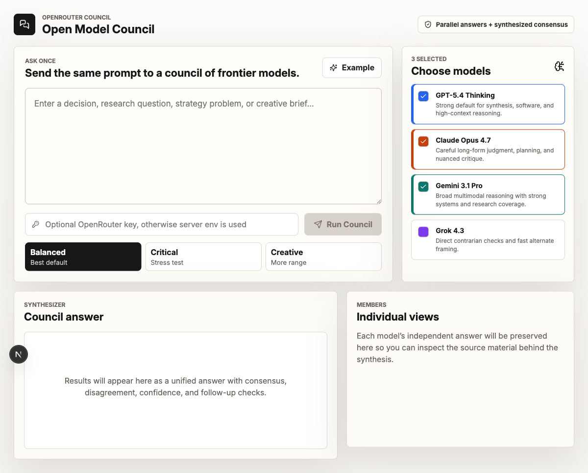

# Consenso IA — Model Council MAGI

> Spanish-language AI model council (draft → debate → synthesis) running mostly-free models via OpenRouter, direct NVIDIA NIM, and direct Google AI Studio, with a MAGI-inspired live status panel — including an optional "MAGI Mode" that assigns each of 3 models a fixed analytical lens (Melchior/Balthasar/Casper). Fork of [sanky369/open-model-council](https://github.com/sanky369/open-model-council).

Le hacés una pregunta a un panel de varios modelos de IA. Cada uno responde por separado, después se **critican entre sí** en una ronda de debate, un modelo juez extrae los consensos y desacuerdos reales, y finalmente un modelo sintetiza todo en una sola respuesta consensuada con el desglose completo de cada paso.



---

## Qué hace

1. **Borradores independientes.** 2 a 10 modelos responden la misma pregunta en paralelo, sin verse entre sí.
2. **Debate.** Cada modelo ve su propio borrador completo + versiones **condensadas** de los borradores de los demás, y produce una crítica + respuesta revisada. Corre hasta un máximo de rondas configurable, pero corta antes si las respuestas convergen (medido por vocabulario compartido entre los modelos); al terminar, cada modelo sobreviviente vota por la respuesta más fuerte del panel.
3. **Juez de fusión.** Un modelo dedicado extrae consenso, contradicciones, insights únicos y vacíos de cobertura entre todos los debates. La sección de contradicciones se muestra en la UI como un **mapa de desacuerdo**: tema por tema, la posición de cada modelo, y el veredicto del juez. Si el proveedor falla, cae a un reporte heurístico local en vez de romper la corrida.
4. **Síntesis final.** Un modelo redacta la respuesta consolidada usando el reporte del juez + todos los borradores/debates.
5. **Preguntas de seguimiento** sugeridas automáticamente, y podés seguir la conversación en el mismo hilo.

Podés inspeccionar cada fase en la UI, ver el **desglose de tokens por paso** (qué fase pesa más — el voto suele ser el más caro, porque manda la respuesta completa de cada modelo a cada votante), y hay una **vista Tribunal** alternativa (estética de terminal ámbar/rojo) para ver el veredicto final de forma más visual.

---

## Modo adaptativo

Activá "Modo adaptativo" en Ajustes → Investigación para que el consejo no debata a ciegas. Antes de arrancar el debate, mide cuánto coinciden ya los borradores independientes (misma heurística léxica top-K que la detección de convergencia mid-debate, pero con un umbral más estricto — 35% en vez de 25% — porque saltar el debate entero es una decisión más grande que solo cortar uno que ya viene convergiendo). Si el acuerdo supera el umbral, se salta tanto el debate como la votación final y va directo a la síntesis, ahorrando esas llamadas cuando el panel ya estaba de acuerdo desde el arranque. Si no, corre el debate normal (con las rondas y la votación configuradas). Cuando se salta, la pestaña Debate muestra el motivo (score de acuerdo y umbral) en vez de dejarla vacía sin explicación.

Inspirado en el proyecto [`magi`](https://github.com/fshiori/magi) (protocolo "adaptive"), aunque con la heurística de similitud recalibrada — su versión usa Jaccard sobre el texto completo con un umbral de 0.8, que en la práctica rara vez dispara con respuestas largas de LLMs reales.

---

## Tracking de cambio de opinión

Después de cada debate, la pestaña Debate muestra si cada modelo **se mantuvo firme** o **cambió de posición** respecto a su propio borrador inicial — comparando su draft independiente contra su respuesta final del debate (misma heurística de vocabulario top-K, pero ahora comparando a un modelo consigo mismo a través del tiempo, no contra los demás). El umbral (40% de similitud) se calibró aparte del resto: como un mismo autor reutiliza frases y estructura incluso cuando cambia de fondo, la autosimilitud de "se mantuvo firme" corre bastante más alta (~0.65-0.8) que la similitud entre modelos distintos — y cualquier cambio real de posición, sea total o parcial, cayó cerca de 0 en las pruebas.

Inspirado en el mismo proyecto [`magi`](https://github.com/fshiori/magi) (que llama a esto `mind_changes`).

---

## Presets de personas del debate

Con **exactamente 3 modelos** seleccionados, podés elegir un "Preset de personas del debate" en Ajustes → Investigación. Le asigna a cada asiento una lente analítica fija durante el debate — mismo asiento en el panel triangular, mismos nombres en los nodos MAGI, pero con distintos sets intercambiables según lo que estés evaluando:

- **MAGI (Evangelion)** — Melchior (la científica: rigor empírico, evidencia verificable), Balthasar (la guardiana: riesgo primero, quién puede salir perjudicado), Casper (la defensora: impacto humano real, contexto social). El preset original, y el que le da nombre al panel.
- **Code Review** — Security (piensa como atacante), Performance (qué se rompe a 100x escala), Quality (mantenibilidad a largo plazo).
- **Research** — Methodologist (rigor del método), Domain Expert (consenso establecido del campo), Devil's Advocate (el mejor contraargumento posible).
- **Writing** — Editor (estructura y economía), Reader (cómo lo vive el lector real), Fact-Checker (verificabilidad de cada dato).
- **Strategy** — Optimist (mejor escenario), Pessimist (peor escenario, riesgos de segundo orden), Pragmatist (qué es realmente ejecutable con los recursos reales).

Los modelos no "actúan" un personaje — el prompt les pide razonar explícitamente desde ese ángulo analítico, como una lente de revisión profesional, no un rol de ficción.

Inspirado en el proyecto [`magi`](https://github.com/fshiori/magi), que tiene el mismo concepto de presets intercambiables (`eva`, `code-review`, `research`, `writing`, `strategy`) — acá con los textos de cada lente reescritos para nuestro propio prompt de debate.

Cuando está activo y hay una corrida en curso, el panel MAGI (triángulo, con exactamente 3 asientos) muestra **MELCHIOR / BALTHASAR / CASPER** en los nodos en vez del nombre del modelo — el asiento sigue siendo el mismo modelo por debajo, la persona es una capa de encuadre sobre el prompt, no un modelo distinto. Si tenés un conteo distinto de 3 modelos seleccionados, el toggle se queda activado pero sin efecto (te avisa en la nota), y vuelve a aplicarse solo apenas volvés a 3 — no hace falta reactivarlo.

---

## Modelos y proveedores

El panel corre **primariamente con modelos gratuitos**. Podés sumar modelos de pago si tenés crédito cargado en OpenRouter (o querés usar tu propia key de NVIDIA/Google), pero nada de esto es obligatorio para que la app funcione.

| Proveedor | Cómo se llama | Requiere |
|---|---|---|
| **OpenRouter** | Modelos `:free` (Nemotron, GPT-OSS, Gemma, Laguna, North Mini Code) | `OPENROUTER_API_KEY` |
| **NVIDIA NIM** (directo) | Fallback automático para modelos Nemotron + 2 modelos nativos (Llama 3.1 8B, GLM-5.2) | `NVIDIA_API_KEY` (opcional) |
| **Google AI Studio** (directo) | 3 modelos Gemini nativos (3.7 Flash, 3.1 Pro Preview, 2.5 Flash-Lite) | `GEMINI_API_KEY` (opcional) |

**Por qué dos proveedores directos además de OpenRouter:** el pool gratuito de OpenRouter es compartido entre todos sus usuarios, así que los modelos más populares se saturan seguido (HTTP 429). NVIDIA y Google ofrecen sus propios cupos gratuitos, separados de ese pool compartido.

**Fallback automático por modelo:** además del fallback general de síntesis, cada modelo del roster puede declarar su propio `fallbackModelId` en `lib/models.ts` — un segundo motor que se prueba si el primero falla, manteniendo la identidad del asiento en toda la UI (el fallback es un cambio de motor invisible, nunca un modelo distinto que tengas que rastrear). Ya configurado con evidencia real de fallas para los 3 Gemini: `gemini-3.1-pro-preview → gemini-2.5-flash` (el Pro no tiene cupo gratuito, ver nota abajo), y `gemini-3.7-flash`/`gemini-3.5-flash → gemini-2.5-flash` por si el 503 persiste tras los reintentos.

### Nota sobre Gemini 3.1 Pro

Confirmado en vivo: este modelo **no tiene cupo gratuito** en Google AI Studio — necesita un proyecto de Google Cloud con facturación habilitada. Por eso tiene fallback automático a Flash configurado por defecto. Flash y Flash-Lite sí tienen cupo gratuito real.

---

## Ingeniería de resiliencia

El pool gratuito compartido de OpenRouter, y en menor medida las APIs directas de NVIDIA/Google, tienen fallas transitorias frecuentes. El sistema está armado para absorber esto sin romper toda la corrida:

- **Timeout real por llamada** (7 minutos por defecto) que se mantiene armado durante toda la lectura de la respuesta, no solo hasta que llegan los headers.
- **Reintento con backoff exponencial** en 429 (rate limit) y 503 (proveedor saturado), y en errores de red genéricos.
- **Reintento en respuesta vacía** para modelos de razonamiento que gastan todo su presupuesto "pensando" sin emitir contenido visible.
- **Watchdog por fase**, techo firme independiente para juez/síntesis/follow-ups.
- **Fallback de modelo dinámico para la síntesis** (nunca el mismo modelo dos veces) y **fallback por modelo individual** (ver arriba).
- **Indicador de confiabilidad por modelo**: ventana móvil de las últimas 8 llamadas por modelo; si falló ≥40% de las recientes, el selector muestra un ícono de advertencia con el motivo del último fallo al pasar el mouse. En memoria, se reinicia si reiniciás el servidor.
- **Logging detallado por consola** en cada paso.

---

## Agente de archivos (opcional)

Uno de los modelos del consejo puede actuar como **agente de archivos**, con herramientas para leer y proponer cambios sobre el proyecto donde corre el servidor:

- `list_directory`, `read_file` — se ejecutan al toque, sin aprobación.
- `propose_write_file`, `propose_edit_file` — nunca escriben directo a disco. Calculan un diff, lo dejan en espera, y **vos lo aprobás desde la UI**.

**Patchset atómico:** si un mismo turno del modelo propone cambios en varios archivos relacionados, la UI los agrupa (mismo `groupId`) con botones "Aplicar todo / Descartar todo" — al aplicar, se escriben en secuencia y si uno falla a mitad de camino no deja el grupo aplicado a medias.

**Auto-verificación de TypeScript real:** para archivos `.ts`/`.tsx`, corre `tsc --noEmit` de verdad contra el proyecto (no un chequeo simulado): escribe el contenido propuesto en el archivo real, corre el check, y lo restaura al contenido original pase lo que pase (bloque `finally`), serializado en una cola para que dos verificaciones no se pisen entre sí. El badge en la tarjeta pasa de "Verificando…" a "✓ Compila" o "✗ N errores" con el detalle expandible — antes de que decidas aprobar o no.

**Modelo de seguridad**: todo path se resuelve contra `AGENT_FS_ROOT` (por defecto, la carpeta del propio proyecto) y se rechaza si intenta salir de ahí, symlinks incluido.

Se activa desde el conector "Filesystem" en Ajustes, eligiendo qué modelo del panel actual actúa como agente.

> **Nota de build:** al compilar para producción vas a ver un warning de Turbopack ("Encountered unexpected file in NFT list") apuntando a `lib/fs-tools.ts`. No rompe el build ni el `npm run dev`/`npm start` local — es Turbopack avisando que no puede acotar con precisión qué archivos empaquetar en la función serverless, por las operaciones de filesystem dinámicas de esta feature. Solo importa si algún día deployás a Vercel u otra plataforma serverless.

---

## Coding Agent (opcional)

Además del consejo, la app trae un **Coding Agent** con su propia UI en `/agent`: elegís un proyecto, escribís una task y el agente lee el repo, propone cambios, corre scripts allowlisted y deja todo listo para revisar. Nada se aplica solo: los cambios pasan por la misma cola de propuestas con aprobación.

**Qué incluye:**

- **Proyectos y tasks persistentes.** `agent_projects`, `agent_tasks`, `agent_workspaces`, `agent_proposals` y `agent_events` viven en SQLite. Cada task tiene su workspace aislado; podés cancelarla, reencolarla o borrarla desde la UI.
- **Dos runtimes.** El **loop legacy** (`lib/agent/loop.ts`) hace tool-use con `generateText` de `ai`, failover de credenciales Step-0 (solo rota si el error ocurrió antes del primer step), context governor y `buildProposals` desde `git status`. El **Autonomous Loop** (`lib/agent/autonomy/dispatcher.ts`) es opt-in con `MAGI_AUTONOMOUS_LOOP=1`: planifica, ejecuta, verifica acceptance machine-checkable y persiste un ledger reanudable.
- **Ledger y resume.** `lib/agent/autonomy/ledger.ts` es la única capa que escribe `agent_runs`, `agent_plans`, `agent_plan_items`, `agent_steps`, `agent_file_checkpoints`, `agent_verifications` y `agent_final_reports`. Valida transiciones y evidencia; sin verificador el resultado es `verification_unavailable`, nunca éxito asumido. Los detalles de límites están en [`docs/ARQUITECTURA-AGENTE.md`](docs/ARQUITECTURA-AGENTE.md).
- **Tools con política.** `read_file`, `list_directory`, `run_script`, `web_search` (requiere `TAVILY_API_KEY`), `typecheck`, propuestas de escritura/edición y borrado controlado. Los scripts solo pueden ser los allowlisted del proyecto; los paths se resuelven contra el workspace y se rechazan symlinks/`..`.
- **Context engine.** Con el engine encendido (default en tasks reales, se apaga con `MAGI_CONTEXT_ENGINE_DISABLED=1`), el agente recibe briefing, repo-map y presupuesto de tokens por paso. Si el engine falla, la task sigue sin contexto automático: nunca rompe la corrida.
- **Aplicación y verificación.** Aplicar una propuesta es explícito; para `.ts`/`.tsx` se corre `tsc --noEmit` real antes de aprobar. Los cambios multiarchivo se agrupan por `groupId`.

**Variables relevantes:** `OPENROUTER_CODING_MODEL`, `MAGI_AUTONOMOUS_LOOP`, `MAGI_CONTEXT_ENGINE_DISABLED`, `AGENT_FS_ROOT`, `TAVILY_API_KEY` (ver `.env.example`). El Coding Agent usa el mismo pool de credenciales OpenRouter que el consejo (`OPENROUTER_API_KEY`, `OPENROUTER_API_KEY_2`, …).

---

## Adjuntos

Podés subir imágenes, archivos de texto, y documentos **PDF/DOCX** — el texto se extrae server-side (`pdf-parse` y `mammoth`) antes de mandarlo al consejo. La extracción es best-effort: un archivo corrupto o escaneado sin OCR no rompe la corrida.

---

## Vista Tribunal

Botón "Tribunal" junto a la respuesta sintetizada — muestra el mismo resultado con una estética alternativa de terminal (ámbar/rojo, tarjetas con esquinas cortadas), con el código de caso, el estado real (resuelto/en disputa según el juez de fusión), y el veredicto de cada modelo.

---

## Panel MAGI

El estado del consejo (en espera, deliberando, completo) se muestra en un panel inspirado en la estética de terminal MAGI — triángulo con líneas conectoras cuando hay 3 modelos (con nombres de persona si Modo MAGI está activo), disposición radial con 4-5, fila simple para el resto. Vive en `app/components/council/`, es autocontenido (estilos con prefijo `.magi*`, no tocan la paleta del resto de la app).

---

## Trazas, export y comparación de corridas

Cada corrida del consejo se persiste en SQLite (`council_runs`, `council_run_usage`, `council_run_events`) con tokens y costo estimado por modelo/fase, latencia, fallbacks, reintentos y todos los eventos del debate. La pestaña **Trazas** de la vista de resultados permite:

- ver el timeline de la corrida y el replay del debate (crítica, respuesta revisada, rationale del voto);
- exportar la corrida como Markdown o JSON (`/api/council/runs/<id>/export?format=...`);
- comparar dos corridas del mismo prompt (deltas de tokens, duración y costo, y modelos que solo aparecen en una).

La persistencia es best-effort: si la DB falla, la corrida sigue y la traza se desactiva. El costo sale de una tabla explícita (`lib/model-pricing.ts`): los modelos `:free` cuestan USD 0 y un modelo pago sin tabla se muestra como “—”, no como 0. Las corridas se pueden listar y borrar por API (`GET/DELETE /api/council/runs...`), y todas las rutas pasan por el proxy de seguridad.

---

## Stack técnico

- **Framework:** Next.js 16 (App Router) + React 19
- **Lenguaje de la UI:** Español
- **Estilos:** CSS plano con sistema de variables (paleta cream/teal estilo Perplexity + panel MAGI independiente)
- **Markdown:** `react-markdown` + `remark-gfm`
- **Íconos:** `lucide-react`
- **Gateways de LLM:** [OpenRouter](https://openrouter.ai) (principal), [NVIDIA NIM](https://build.nvidia.com) y [Google AI Studio](https://aistudio.google.com) (directos)
- **Extracción de documentos:** `pdf-parse`, `mammoth`
- **Persistencia:** SQLite local con `better-sqlite3` en `data/council.db` (hilos, tasks del Coding Agent, proyectos, workspaces, propuestas, eventos y ledger de autonomía). `localStorage` queda solo para preferencias de UI (skills, conectores, hilos migrados una vez).
- **Coding Agent:** `ai` SDK + tools nativas, con loop legacy y Autonomous Loop opt-in (`MAGI_AUTONOMOUS_LOOP=1`).
- **Requisito:** Node **>= 22** (`package.json` → `engines.node`). `better-sqlite3` es nativo: si tu Node no tiene binario prebuilt, necesita toolchain de compilación (Python + C++ build tools).

---

## Instalación rápida

### 1. Clonar e instalar

Requisitos: **Node >= 22** y npm. En Windows conviene una terminal con permisos de build si `better-sqlite3` no encuentra un prebuilt.

```bash
git clone https://github.com/enzoayala32/model-council-magi.git
cd model-council-magi
npm install
```

La primera ejecución crea `data/council.db` y aplica el schema con `CREATE TABLE IF NOT EXISTS` (sin servicio externo ni migraciones manuales). El archivo está ignorado por git; no lo commitees.

### 2. Configurar variables de entorno

```bash
cp .env.example .env
```

Como mínimo necesitás `OPENROUTER_API_KEY` ([conseguí una gratis acá](https://openrouter.ai/keys)). `NVIDIA_API_KEY`, `GEMINI_API_KEY` y `TAVILY_API_KEY` son opcionales. El `.env.example` documenta **todas** las variables que lee el código, incluidas las de seguridad de `/api/*` y los flags del Coding Agent.

### 3. Correr en desarrollo

```bash
npm run dev
```

Abrí [http://localhost:3000](http://localhost:3000). Si usás otro puerto, definí `PORT` o `ALLOWED_HOSTS` (ver seguridad).

### 4. Build de producción

```bash
npm run build
npm start
```

### 5. Verificación local

```bash
npm run typecheck   # tsc --noEmit
npm run lint        # eslint .
npm test            # suite offline (sin proveedores reales)
npm run test:live   # suite que sí llama a proveedores (requiere keys)
```

`npm test` descubre los scripts `council:test-*` y `provider-resilience:test-*` por prefijo y omite los live, `agent:test-project` (manual) y los agrupadores `agent:test-phase8`/`phase9` (sus sub-tests ya corren). El runner imprime qué omitió y por qué.

---


## Seguridad de la API (Fase 1)

La app sigue siendo **single-user y self-hosted**: no hay login ni multiusuario. Lo que se agregó es una puerta de entrada para que una página web ajena abierta en el mismo navegador no pueda hablarle a `localhost` a través de `/api/*`.

`proxy.ts` (el reemplazo de `middleware.ts` en Next 16) intercepta `/api/:path*` y aplica, en este orden:

1. **Host permitido** — por defecto `localhost`, `127.0.0.1` y `[::1]` con el puerto de `PORT` (o `3000`). Se configura con `ALLOWED_HOSTS` (lista separada por comas; una entrada sin puerto acepta cualquier puerto de ese host). Esto también corta **DNS rebinding**: un dominio atacante que resuelve a `127.0.0.1` manda su propio `Host`, que no está en la allowlist.
2. **Token opcional** — si `APP_ACCESS_TOKEN` está definido, todo `/api/*` exige `Authorization: Bearer <token>` o la cookie `magi_access_token=<token>`. Si no está definido, el comportamiento es el de siempre.
3. **Origin / Sec-Fetch-Site** — en `POST`, `PUT`, `PATCH` y `DELETE`, si viene `Origin` tiene que estar en `ALLOWED_ORIGINS` (por defecto, el mismo origen del `Host` permitido, en `http` y `https`). Si no viene `Origin`, se rechaza `Sec-Fetch-Site: cross-site`. Un cliente que no es navegador (curl, un script) no manda `Origin` ni `Sec-Fetch-Site` y se deja pasar a propósito.
4. **Content-Type** — si el método muta y hay body, tiene que ser `application/json` o `*+json`. Las rutas que no reciben body (`cancel`, `discard`, `apply`, deletes) siguen funcionando sin `Content-Type`.

Los rechazos devuelven JSON en español: `403` para Host/Origin/token/`Content-Type`, siempre con la forma `{ "ok": false, "error": "..." }`. Un body JSON inválido devuelve `400` con la misma forma, en vez de un 500.

Variables nuevas (ver `.env.example`):

| Variable | Default | Para qué |
|---|---|---|
| `ALLOWED_HOSTS` | `localhost:3000,127.0.0.1:3000,[::1]:3000` | Hosts aceptados por el proxy |
| `ALLOWED_ORIGINS` | mismo origen del Host permitido | Orígenes aceptados en métodos que mutan |
| `APP_ACCESS_TOKEN` | vacío (sin token) | Cerradura opcional para `/api/*` |

Si corrés en otro puerto, definí `PORT` o `ALLOWED_HOSTS`; si estás detrás de un reverse proxy con otro dominio público, agregalo a `ALLOWED_HOSTS` y `ALLOWED_ORIGINS`.

---

## Estructura del proyecto

```
proxy.ts                          # seguridad /api/* (Host, Origin, token, Content-Type)
next.config.ts                    # config de Next + tracing
eslint.config.mjs                 # flat config (eslint-config-next)
scripts/run-tests.ts              # runner de la suite offline/live

app/
  layout.tsx, globals.css, icon.svg
  page.tsx                        # UI del consejo (configuración + render)
  agent/                          # UI del Coding Agent (/agent)
    page.tsx, ProjectPicker.tsx, useAgentTaskEvents.ts, agent.css
  hooks/
    useCouncilRun.ts              # motor cliente de la corrida (SSE, estado, propuestas)
    useThreads.ts                 # hilos + snapshot del turno
    useModelHealth.ts, useModelPing.ts
  components/
    council/                      # panel MAGI autocontenido
    main/                         # sidebar, composer, settings, results, vistas
  api/
    council/
      stream/route.ts             # plomería HTTP/SSE → lib/council-orchestrator.ts
      runs/                       # trazas: listado, detalle, export md/json, compare
      apply-file-change/          # aprobación de cambios (grupos atómicos)
      model-health/, ping/
    agent/
      tasks/                      # CRUD, cancel, apply, events, browse, inspect
      projects/, models/
    threads/                      # GET/POST/DELETE + migrate (localStorage → SQLite)
    provider-resilience/status/   # snapshot de credenciales/pool

lib/
  council-orchestrator.ts         # pipeline draft → debate → voto → juez → síntesis
  council-run.ts                  # draft/debate/vote/judge + failover + watchdog
  council-consensus.ts            # convergencia, votos, mind-change, parsing
  council-prompts.ts              # prompts de cada fase
  council-types.ts                # StreamRequest/StreamEvent compartidos
  council-run-store.ts            # recorder + persistencia de corridas (best-effort)
  council-run-trace.ts            # timeline, replay, comparación y export Markdown
  model-pricing.ts                # tabla de precios y costo estimado por modelo
  persona-presets.ts              # presets MAGI/code-review/research/writing/strategy
  models.ts                       # catálogo, fallbackModelId, paneles de fusión
  openrouter.ts, nvidia.ts, google-ai-studio.ts, llm-shared.ts
  model-health.ts, model-ping.ts
  agent-tools.ts, fs-tools.ts     # tools GitHub y filesystem + auto-verificación TS
  attachment-extraction.ts        # PDF/DOCX → texto
  api-security.ts, api-json.ts    # reglas de seguridad y body JSON uniforme
  db.ts                           # SQLite (better-sqlite3), schema y PRAGMA user_version
  threads.ts, threads-db.ts       # hilos: cliente y persistencia
  skills.ts
  agent/                          # Coding Agent
    loop.ts                       # runtime legacy (generateText + tools)
    runner.ts                     # task → workspace → loop/autonomía → estado
    tools.ts, tool-policy.ts, safe-path.ts
    task-store.ts, project-store.ts, workspace-*.ts, proposal-*.ts, event-log.ts
    apply.ts, repo-*.ts, dependency-graph.ts, read-range.ts, search-provider.ts
    context/                      # engine, briefing, budget, governor, sensitive-paths
    autonomy/                     # contract, plan, ledger, dispatcher, verifier, resume
  provider-resilience/            # pool, cooldown, classify, redact, config, events

data/council.db                   # SQLite local (ignorado por git)
docs/REPORTE-REFACTOR.md          # reporte de este refactor
docs/ARQUITECTURA-AGENTE.md       # límites ledger.ts / loop.ts + plan de división
docs/ROADMAP.md                   # estado de cada frente (consejo, agente, remoto, MCP)
```

Los archivos `test-*.ts` viven junto al módulo que prueban (`lib/`, `lib/agent/`, `lib/agent/autonomy/`, `lib/agent/context/`, `lib/provider-resilience/`) y se ejecutan con `tsx` vía scripts de `package.json`.

---

## Créditos

Fork de [sanky369/open-model-council](https://github.com/sanky369/open-model-council), la implementación original del concepto "Model Council" estilo Perplexity. Esta versión suma: traducción completa al español, proveedores directos de NVIDIA/Google además de OpenRouter con fallback por modelo, ingeniería de resiliencia extensa, agente de archivos con aprobación (patchsets atómicos y auto-verificación de TypeScript real), extracción de PDF/DOCX, mapa de desacuerdo visual, el panel MAGI con Modo MAGI opcional, persistencia SQLite para hilos y tasks, y un Coding Agent con loop legacy + Autonomous Loop reanudable.

Inspiraciones adicionales: [`magi`](https://github.com/fshiori/magi) para el protocolo adaptativo, los presets de personas y el tracking de cambio de opinión. El concepto "Model Council" original es de [sanky369/open-model-council](https://github.com/sanky369/open-model-council).
